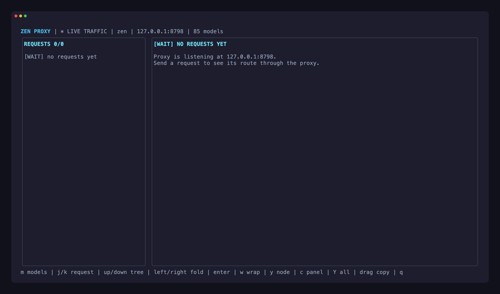
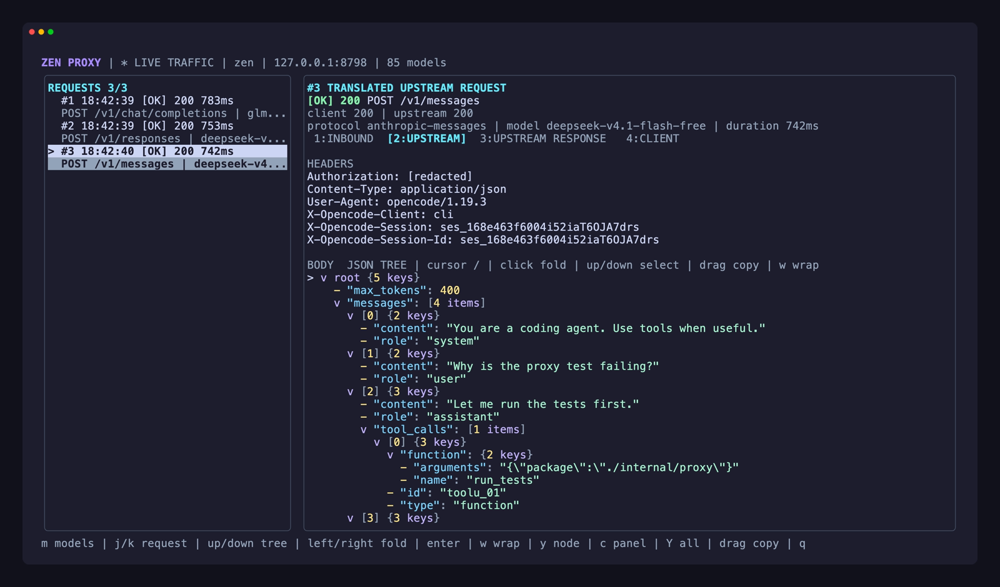
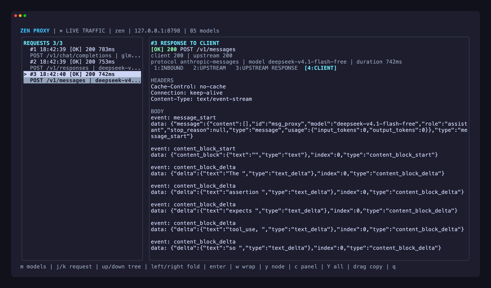
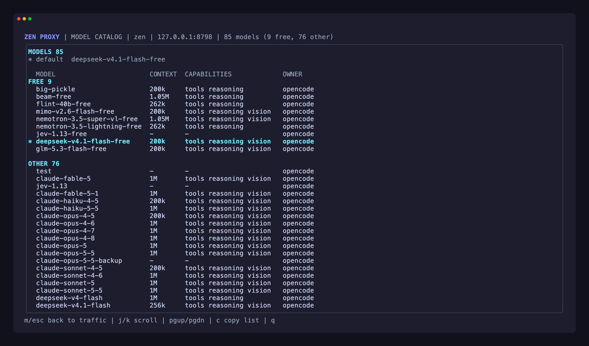

# zen-proxy

Single-binary proxy that lets **Claude Code**, **Codex**, and any OpenAI-compatible tool use [OpenCode Zen](https://opencode.ai/zen) or [OpenRouter](https://openrouter.ai/) models.

```
Claude Code ──→ /v1/messages (Anthropic)  ──┐
Codex       ──→ /v1/responses (OpenAI)    ──┼──→ Chat Completions ──→ Zen or OpenRouter
Cursor etc  ──→ /v1/chat/completions      ──┘
```

No runtime dependencies. Zen's free models work without an API key; OpenRouter needs your OpenRouter key.
Streaming, tool calls (including parallel calls), and thinking/reasoning blocks are translated in both directions.

<p align="center">
  
</p>

## Quick start

```bash
curl -fsSL https://raw.githubusercontent.com/azain47/zen-proxy/main/install.sh | sh
zen-proxy
```

```
zen-proxy v0.3.0
  ready    http://127.0.0.1:8788
  route    zen -> https://opencode.ai/zen/v1/chat/completions
  model    deepseek-v4.1-flash-free
  catalog  85 models (9 free, 76 other)
  metadata 81/85 matched
  inspect  zen-proxy --tui
```

Then point a client at it (below). `zen-proxy models` prints the current catalog
grouped into free and other models; the list changes as providers add and retire models.

```bash
zen-proxy models           # list current upstream models
zen-proxy --tui            # live request inspector
zen-proxy --verbose        # log sanitized request traces to stderr (alias: --debug)
zen-proxy --check-update   # compare with the latest release
zen-proxy --version
```

## Clients

### Claude Code

```bash
export ANTHROPIC_BASE_URL=http://localhost:8788
export ANTHROPIC_API_KEY=anything
export ANTHROPIC_MODEL=deepseek-v4.1-flash-free
claude
```

Switch models in-session with `/model`, using any id from `zen-proxy models`.

### Codex

With the proxy running, install a Codex profile:

```bash
./scripts/install-codex-profile.sh
codex --profile zen-proxy
codex --profile zen-proxy -m glm-5.3-flash-free   # pick another model
```

The script writes `~/.codex/zen-proxy.config.toml`, which Codex 0.134.0+ loads for
`--profile zen-proxy`. Manual equivalent:

```toml
model = "deepseek-v4.1-flash-free"
model_provider = "zen-proxy"

[model_providers.zen-proxy]
name = "zen-proxy"
base_url = "http://127.0.0.1:8788/v1"
wire_api = "responses"

[model_providers.zen-proxy.auth]
command = "/usr/bin/printf"
args = ["zen-proxy"]
timeout_ms = 1000
refresh_interval_ms = 0
```

- Codex reads per-model context windows, reasoning levels, and agent instructions
  from the proxy's `/v1/models`. Set `ZEN_PROXY_CODEX_CONTEXT_WINDOW` or
  `ZEN_PROXY_CODEX_COMPACT_LIMIT` before running the script only if you want fixed values.
- The command-auth token is not a secret and is not validated. It exists because
  Codex refreshes a custom provider's `/models` only when the provider uses command auth.
- Don't use `OPENAI_BASE_URL` alone: Codex stays on its built-in OpenAI provider,
  and ChatGPT-account auth can reject non-OpenAI model names before they reach the proxy.

**Agent instructions.** Every advertised model carries a bundled copy of Codex's
official agent prompt (`codex-rs/models-manager/prompt.md` from
[openai/codex](https://github.com/openai/codex), Apache-2.0) as `base_instructions`.
To replace it, set `ZEN_PROXY_CODEX_INSTRUCTIONS_FILE=/path/to/prompt.md`. The file
is read once at startup; if it's unreadable the proxy warns and uses the bundled prompt.

### Cursor, Continue, and other OpenAI-compatible tools

- Base URL: `http://localhost:8788/v1`
- API key: anything (not validated)
- Model: any id from `zen-proxy models`

## Providers

**Zen, free (default).** No key needed. The proxy uses Zen's public key and sends
OpenCode client headers, which Zen's free tier requires.

**Zen, paid.** Set your OpenCode API key to use the paid models
(e.g. `claude-opus-4-8`, `gpt-5.1`, `deepseek-v4-pro`):

```bash
ZEN_API_KEY=sk-your-key zen-proxy
```

**OpenRouter.**

```bash
ZEN_PROVIDER=openrouter OPENROUTER_API_KEY=sk-or-v1-your-key zen-proxy
```

This targets `https://openrouter.ai/api/v1/chat/completions` with fallback model
`openrouter/free`. Any OpenRouter id works, including `:free` models such as
`qwen/qwen3-coder:free`. The startup summary and `zen-proxy models` count only
free *text* models as free; `/v1/models` still returns the full list. Set
`OPENROUTER_HTTP_REFERER` and `OPENROUTER_APP_TITLE` for OpenRouter attribution.

The proxy passes through whatever model the client sends; `ZEN_MODEL` is only a
fallback for requests without one. If the built-in fallback disappears from the
catalog, the proxy picks a current model instead (a free text model on
OpenRouter). An explicit `ZEN_MODEL` is never replaced.

## Request inspector

`zen-proxy --tui` opens a live dashboard of the last 100 requests. Each request has
four panels: the inbound request, the translated upstream request, the upstream
response, and the response sent to the client. JSON bodies render as a
collapsible, syntax-colored tree. Statuses stay readable without color
(`[WAIT]`, `[OK]`, `[WARN]`, `[ERR]`).

<table>
  <tr>
    <td width="50%"></td>
    <td width="50%"></td>
  </tr>
  <tr>
    <td align="center"><sub>An Anthropic <code>tool_use</code> leaving as OpenAI <code>tool_calls</code></sub></td>
    <td align="center"><sub>The reply streamed back as Anthropic SSE events</sub></td>
  </tr>
  <tr>
    <td colspan="2"></td>
  </tr>
  <tr>
    <td colspan="2" align="center"><sub>Press <code>m</code> for the model catalog</sub></td>
  </tr>
</table>

| Key | Action |
|-----|--------|
| `j`/`k`, `n`/`p` | Select request |
| `1`-`4`, Tab/Shift-Tab, `[`/`]` | Switch panel |
| Up/Down | Move through JSON nodes |
| Left/Right, Enter | Fold/unfold a node |
| `w` | Toggle wrapping; when off, `h`/`l` pan and `0` resets |
| PgUp/PgDn, `Ctrl+U`/`Ctrl+D`, Home/End | Scroll |
| `y` / `c` / `Y` | Copy node / panel / whole trace as Markdown |
| `m` | Model catalog: every model's context window, capabilities, and owner; default marked `*` (`m` or Esc returns) |
| `q` | Quit |

The mouse works too: the wheel scrolls, and clicking selects requests, switches
tabs, and folds JSON nodes. Dragging selects a region and copies it on release.
Copies go through OSC 52, so they work over SSH in supporting terminals.
`--no-color`, `NO_COLOR`, or `TERM=dumb` disable colors.

## Configuration

| Env var | Default | Description |
|---------|---------|-------------|
| `ZEN_HOST` | `127.0.0.1` | Listen host. Use `0.0.0.0` only if you want network access |
| `ZEN_PORT` | `8788` | Listen port |
| `ZEN_PROVIDER` | `zen` | `zen` or `openrouter` |
| `ZEN_API_KEY` | `public` (Zen) | Upstream API key |
| `ZEN_MODEL` | `deepseek-v4.1-flash-free` (Zen), `openrouter/free` | Fallback model for requests without one |
| `ZEN_UPSTREAM` | provider preset | Upstream chat completions URL |
| `ZEN_MODELS_URL` | provider preset | Upstream models URL |
| `ZEN_MODEL_METADATA_URL` | `https://models.opencode.ai/api.json` (Zen), unset (OpenRouter) | Capability catalog (OpenCode or LiteLLM format); `off` disables |
| `ZEN_FREE_TIER_CLIENT` | on for keyless Zen | Send OpenCode client headers upstream |
| `ZEN_OPENCODE_VERSION` | `1.19.4` | OpenCode version reported in those headers |
| `ZEN_CORS_ORIGINS` | unset | Comma-separated browser origins allowed to call the proxy. Browser requests are denied by default; CLI clients don't need CORS |
| `ZEN_VERBOSE` / `ZEN_DEBUG` | unset | Same as `--verbose` |
| `ZEN_TUI` | unset | Same as `--tui` |
| `OPENROUTER_API_KEY` | unset | Used when `ZEN_PROVIDER=openrouter` and `ZEN_API_KEY` is unset |
| `OPENROUTER_HTTP_REFERER` / `ZEN_HTTP_REFERER` | unset | OpenRouter attribution header |
| `OPENROUTER_APP_TITLE` / `ZEN_APP_TITLE` | `zen-proxy` | OpenRouter attribution header |
| `ZEN_PROXY_CODEX_INSTRUCTIONS_FILE` | unset | Replace the bundled Codex agent prompt |

**Model metadata.** Provider-reported context windows win; the metadata catalog
fills in missing context windows and known reasoning, parallel-tool, and vision
capabilities. Models with no metadata get conservative `low`/`medium`/`high`
reasoning controls. Anthropic `output_config.effort` is forwarded as the upstream
`reasoning_effort`, with thinking budgets as a fallback.

## Endpoints

| Method | Path | Protocol |
|--------|------|----------|
| POST | `/v1/messages` | Anthropic Messages |
| POST | `/v1/messages/count_tokens` | Anthropic token-count estimate |
| POST | `/v1/responses` | OpenAI Responses |
| POST | `/v1/chat/completions` | OpenAI Chat Completions |
| GET | `/v1/models` | Model list fetched from the upstream at startup |
| GET | `/health` | Health check |

All requests are translated to Chat Completions, forwarded upstream, and the
response is translated back to the caller's protocol.

## Security

zen-proxy is a local developer tool. It listens on `127.0.0.1` and does not
authenticate incoming requests, so don't expose it to the internet; if you set
`ZEN_HOST=0.0.0.0`, put your own network controls in front of it. Provider keys
are forwarded only to the configured upstream. Normal mode stores no request
bodies, responses, or keys; `--verbose` and `--tui` keep a bounded, sanitized
in-memory history. See [SECURITY.md](SECURITY.md).

## Other install methods

```bash
go install github.com/azain47/zen-proxy/cmd/zen-proxy@latest
```

```bash
git clone https://github.com/azain47/zen-proxy && cd zen-proxy
make build          # or ./install.sh to build and install
```

The installer downloads the release for your platform, verifies its SHA-256
checksum when `sha256sum` or `shasum` is available, and installs into
`/usr/local/bin` or `~/.local/bin`. Inside a checkout it builds from source.
`./install.sh --check-update` compares the installed binary with the latest release.

| Env var | Description |
|---------|-------------|
| `ZEN_PROXY_VERSION` | Release tag to install (default: `latest`) |
| `ZEN_PROXY_BINDIR` | Install directory |
| `ZEN_PROXY_REPO` | GitHub `owner/repo` for installs and update checks |
| `ZEN_PROXY_FROM_SOURCE=1` | Force a source build |

## Development and releases

```text
cmd/zen-proxy/      CLI entrypoint and version wiring
internal/proxy/     protocol translation, upstream handling, config, dashboard, tests
.github/workflows/  CI and release automation
install.sh          standalone installer
```

`make test`, `make vet`, and `make build` cover day-to-day work.
`make release VERSION=v0.3.0` cross-builds macOS, Linux, and Windows (amd64 and
arm64) into `dist/` as `zen-proxy_<os>_<arch>.tar.gz` (`.zip` on Windows), each
with the licenses, plus `dist/checksums.txt`.

Releases are cut from `main`, which is protected: merge through a reviewed pull
request with passing CI, then tag from an up-to-date `main`:

```bash
git switch main && git pull
git tag -a v0.3.0 -m "zen-proxy v0.3.0"
git push origin v0.3.0
```

The `v*` tag triggers the release workflow, which reruns the tests, builds the
artifacts, and publishes a GitHub Release. Published tags are protected, so ship
fixes as a new patch or minor version rather than re-pushing a tag.

## License

Zen Proxy's original code is MIT licensed. The bundled OpenAI Codex agent
prompt is Apache-2.0 licensed. See [THIRD_PARTY_NOTICES.md](THIRD_PARTY_NOTICES.md)
and [LICENSES/Apache-2.0.txt](LICENSES/Apache-2.0.txt).
